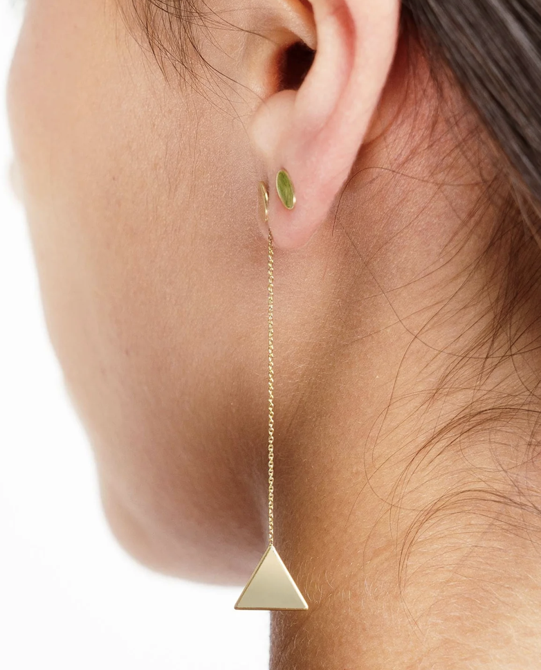

# GeorgeThePapaya.github.io

<h1> I think, therefore, I am.</h1>
<h2> Full-Stack Course, 10/13/2026 </h2>

Body text.

<h2> The Whispering Earring (Excerpt) </h2>

In the treasure-vaults of Til Iosophrang rests the Whispering Earring, buried deep
beneath a heap of gold where it can do no further harm.

The earring is a little topaz tetrahedron dangling from a thin gold wire. When worn, it
whispers in the wearer's ear: "Better for you if you take me off." If the wearer ignores
the advice, it never again repeats that particular suggestion.

